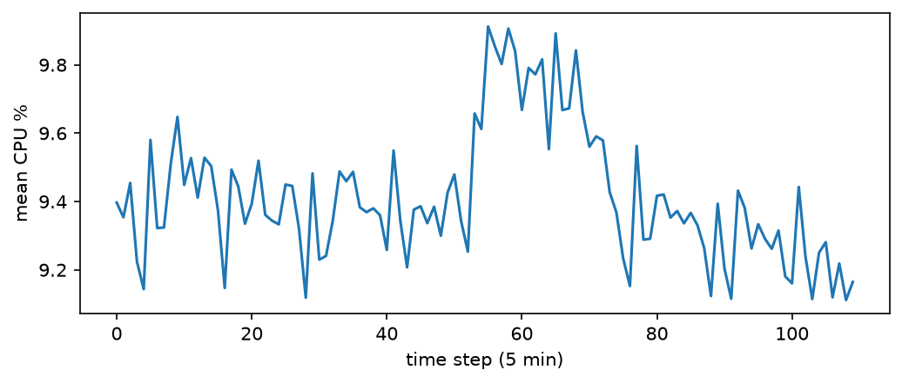
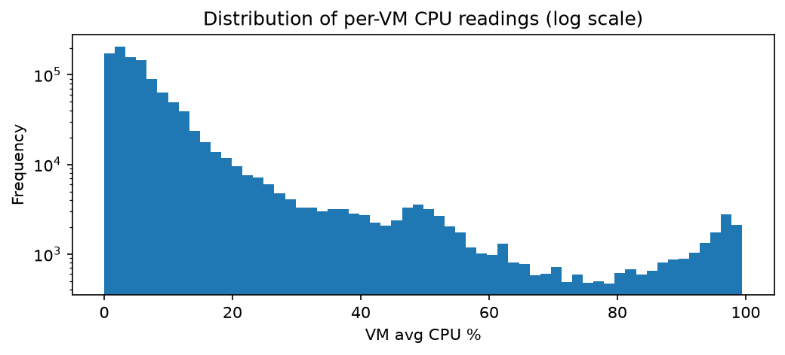
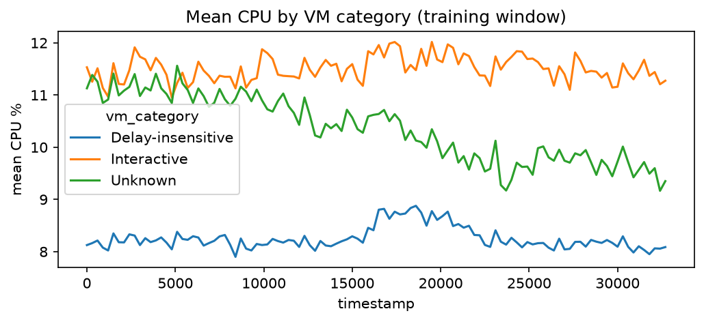
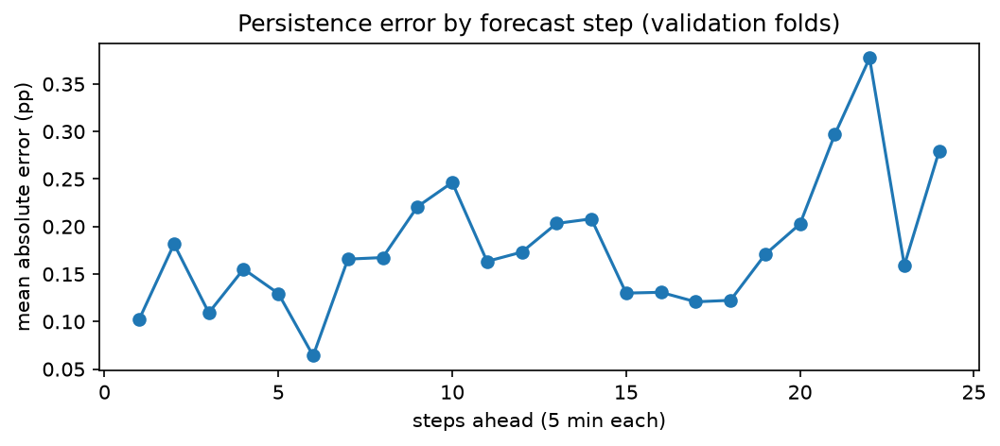

# Cloud Workload Forecasting: Report

## 1. Executive summary

I forecast two series for the final 2 hours (24 steps of 5 minutes) of an Azure VM trace: `active_vm_count` and `aggregate_cpu_utilization`. Eight simple candidate models from four families were compared with time-ordered validation. Persistence (repeat the last value) was best for CPU, with a validation MAE of 0.178 percentage points, and no other model beat it. For `active_vm_count` every model was exactly correct (a tie), because no VM is created or deleted in the window, so the forecast is the constant 10,000. I recommend reserving the forecast plus [FILL: k x RMSE] percentage points of CPU, together with a separate watch on the hottest VMs. Final holdout result: [FILL].

## 2. Data and preprocessing

The readings file has 1,340,000 rows (10,000 VMs x 134 timestamps) with no missing values and no duplicate VM-timestamp pairs. Timestamps form a complete 300-second grid, so no resampling or filling was needed. Targets are built per timestamp: `active_vm_count` counts each VM once, and `aggregate_cpu_utilization` is the mean `avg_cpu` over valid readings (0 to 100). The first 110 timestamps are training data. The last 24 are used only to label the predictions.

The model works at the native 5-minute cadence, so each of the 24 predictions maps one-to-one to a holdout timestamp. The `timestamp` column in `predictions.csv` keeps the source values in seconds.

## 3. Workload analysis

**Zero churn.** All 10,000 VMs were created at the start of the trace and none was deleted inside the window (median lifetime about 720 hours). So `active_vm_count` is constant at 10,000. *So what:* VM count needs no model, but this may not hold outside an 11-hour window.

**Flat fleet average.** Fleet-average CPU has mean 9.41%, standard deviation 0.19 and range 9.11% to 9.91%. Lag-1 autocorrelation is 0.67. *So what:* the latest value is informative, which is why persistence is a strong baseline. [FILL: peak steps and where the series ends, from fig_cpu.png]

**Skewed per-VM CPU.** The median VM reading is 5.1%, the 95th percentile is 37.3% and the 99th is 87.4%. *So what:* the fleet average hides a small group of very hot VMs, so capacity based on the average alone could miss local overload.

**Segments differ.** Interactive VMs average 11.5% CPU, Delay-insensitive 8.3%, and Unknown 10.4%. About 75% of readings come from 2-core VMs, and the largest core buckets have too few VMs for conclusions. *So what:* Interactive VMs are user-facing and hotter, so they deserve separate monitoring.

## 4. Forecasting approach

Candidates: persistence; moving averages over 3, 12 and 36 steps; exponential smoothing (alpha 0.2 and 0.5); and ridge autoregression on the last 3 or 6 values. They were chosen because the history is only 110 points of a flat series, which cannot support seasonal or complex models. All features are computed from past values only. The model for each target is picked by validation MAE.

## 5. Validation method

Models were compared with rolling-origin validation inside the 110 training points only. Each fold learns on all data up to an origin, forecasts the next 24 steps and compares them with what actually happened. The first origin is step 55 (half the training data) and the origin moves forward by 12 steps, which gives 3 folds (origins 55, 67 and 79) and 72 validation points. The folds overlap and there are only three of them, so the conclusions are cautious. Rows were never shuffled. Every choice (candidate models, settings and the final model) used these folds only.

Leakage safeguards: the last 24 target values were never used to fit, tune or choose a model, and they appear in the code only as timestamps. Statistics such as the peak threshold are computed from data before each forecast origin. The code was frozen before the holdout was checked, and the holdout was checked once.

## 6. Results vs baseline

Validation results for `aggregate_cpu_utilization` (percentage points of CPU; `peak_MAE` is the error on the top 20% of values known at each origin):

| Model | MAE | RMSE | sMAPE % | MAE vs persistence | Peak MAE |
|---|---|---|---|---|---|
| persistence | 0.1784 | 0.2260 | 1.88 | 1.00 | 0.1330 |
| ar_ridge_3 | 0.1927 | 0.2371 | 2.03 | 1.08 | 0.3092 |
| ar_ridge_6 | 0.1944 | 0.2407 | 2.05 | 1.09 | 0.3057 |
| exp_smooth_0.5 | 0.2020 | 0.2552 | 2.12 | 1.13 | 0.1690 |
| moving_avg_3 | 0.2030 | 0.2526 | 2.13 | 1.14 | 0.2049 |
| exp_smooth_0.2 | 0.2361 | 0.2825 | 2.48 | 1.32 | 0.2526 |
| moving_avg_36 | 0.2466 | 0.2782 | 2.60 | 1.38 | 0.3311 |
| moving_avg_12 | 0.2891 | 0.3300 | 3.04 | 1.62 | 0.3045 |

No model beat persistence. The closest was ridge AR with 3 lags, 8% worse on MAE. For `active_vm_count` every model had zero error on every fold, so the table shows no difference between them. Percentage metrics are not informative for a constant series.

Final holdout result (checked once, after the code was frozen): [FILL after running --final-holdout]

## 7. Error and failure analysis

**Peaks.** Persistence is also the best model on peak periods (peak MAE 0.133). The ridge AR models and the long moving averages have a peak MAE of about 0.31 to 0.33, more than double persistence. This is consistent with forecasts being pulled toward the average, but I did not inspect individual folds, so this is a likely explanation rather than a proven one.

**Error by step ahead.** The error is noisy and rises only mildly with the horizon: the average MAE is 0.16 percentage points for steps 1 to 12 and 0.20 for steps 13 to 24. The largest error is at step 22 (0.377) and the smallest at step 6 (0.064). With only three overlapping folds, individual steps should not be over-interpreted.

**The series ends below its average.** The last 10 training values lie between 9.11 and 9.44 (mostly 9.1 to 9.3), while the training mean is 9.41. Models that average over longer windows or revert to the mean forecast a level higher than where the series currently sits, which is consistent with persistence winning.

**Other failure modes.** The history is only 110 points, so daily cycles cannot be learned. `active_vm_count` has no variation, so there is nothing to forecast beyond the constant.

## 8. Capacity recommendation

Policy: `capacity(t) = forecast(t) + k x RMSE_validation`, applied to fleet-average CPU. The validation RMSE of persistence is 0.226 percentage points. Coverage is the share of validation points where the actual value stayed under the line (72 points):

| k | Margin (pp) | Coverage |
|---|---|---|
| 0.5 | 0.11 | 79.2% |
| 1.0 | 0.23 | 91.7% |
| 1.28 | 0.29 | 97.2% |
| 1.64 | 0.37 | 100% |
| 2.0 | 0.45 | 100% |

I recommend k = 1.28, the smallest tested value that reaches a 95% coverage target. Going to k = 1.64 adds 0.08 percentage points of reserve for no extra observed coverage, but it is a reasonable choice for user-facing workloads where an outage is costly.

| | Under-provision (margin too small) | Over-provision (margin too big) |
|---|---|---|
| Effect | Slow or failed requests, emergency scaling | Paying for unused capacity |
| Cost | Hard to predict, can be large | Steady and predictable |
| Worse for | Interactive, user-facing workloads | Batch / delay-insensitive workloads |

Extra rules:
- **Segment rule:** use a larger margin for Interactive VMs (hotter, 11.5% vs 8.3% average CPU) and a smaller one for Delay-insensitive VMs, which can wait.
- **Tail monitor:** the fleet average is very stable, but the 99th percentile VM reaches 87% CPU. The fleet-level margin does not protect individual VMs, so also watch the share of VMs above 80% CPU.
- **VM count:** reserve for 10,000 VMs. There was no churn in this window, but this may change over longer periods.

## 9. Limitations and future work

The model is trained on 110 points (about 9 hours) from one fleet, with no daily cycle visible, so the recommendation is credible for the next 2 hours only. Validation has only three overlapping folds, and the chosen k is based on 72 correlated points, so the coverage numbers are rough. The margin is expressed in fleet-average CPU and is not a per-VM guarantee. Future work: segment-level forecasts (Interactive vs Delay-insensitive), prediction intervals from validation residuals, a tail-share target (VMs above 80% CPU), and more history to test daily patterns.